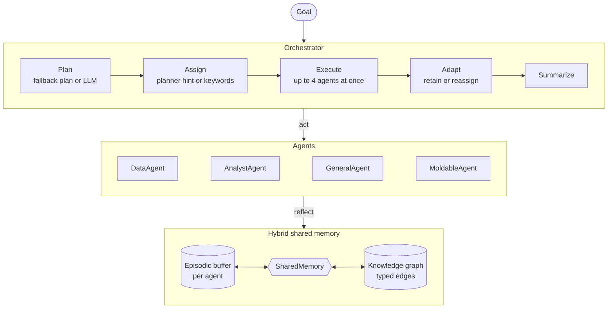
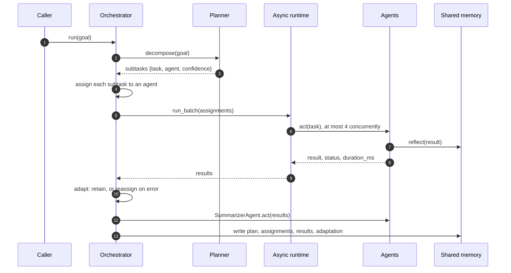
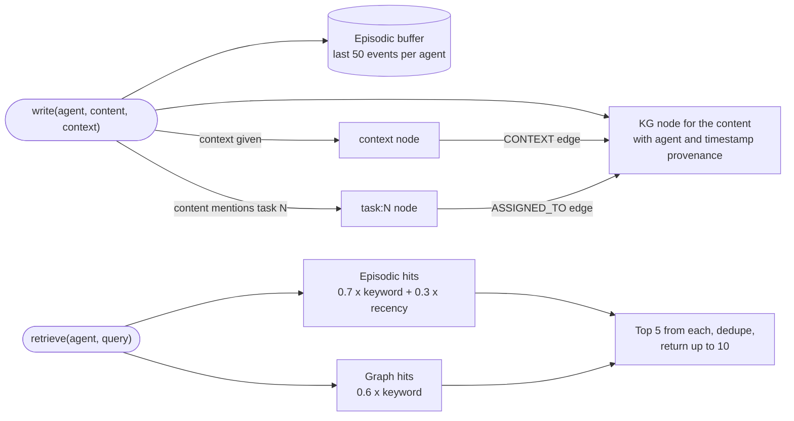
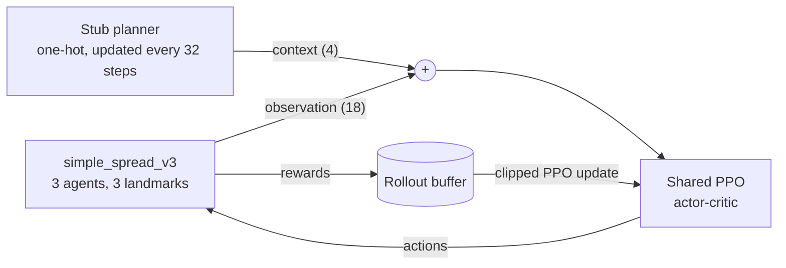

<div align="center">

# Myndra

**A multi-agent playground: an orchestrator that plans, routes, and adapts a team of agents<br>over a hybrid shared memory, plus a small PPO testbed for planner-conditioned MARL.**

[](https://github.com/ysham123/Myndra/actions/workflows/python-tests.yml)


[Architecture](#architecture) · [Orchestrator](#orchestrator) · [Shared memory](#hybrid-shared-memory) · [MARL testbed](#marl-testbed) · [Quick start](#quick-start)

</div>

---

## At a glance

| | Component | What it does | Code |
| :---: | --- | --- | --- |
| 🧭 | **Orchestrator** | Breaks a goal into subtasks, routes each to an agent, runs them concurrently, flags failures, and writes a summary | [`orchestrator/`](orchestrator) |
| 🤝 | **Agents** | Five agent types sharing one lifecycle: act, reflect into memory, adjust confidence from feedback | [`agents/`](agents) |
| 🧠 | **Hybrid shared memory** | A rolling episodic buffer per agent and a knowledge graph, behind one write and one scored retrieval call | [`memory/`](memory) |
| ⏱️ | **Profiler** | Per-stage timers and metrics for orchestrator runs and training | [`systems/`](systems) |
| 🎯 | **MARL testbed** | Shared-parameter PPO on PettingZoo's cooperative navigation task, with an optional context vector per agent | [`marl/`](marl) |

## Architecture



## Orchestrator

One call to `Orchestrator.run(goal)` moves through five timed stages:



| Stage | Behavior |
| --- | --- |
| **Plan** | A fixed four-step plan with explicit dependencies by default. With `MYNDRA_USE_LLM=1`, a memory-aware LLM planner returns structured `{task, agent, confidence}` subtasks (model set by `MYNDRA_PLANNER_MODEL`). |
| **Assign** | Uses the agent the planner names, resolving aliases such as `analyst`, `planner`, and `executor`. Otherwise routes by keywords: *data/gather* to `DataAgent`, *analyze/pattern* to `AnalystAgent`, *summarize/report* to `SummarizerAgent`, and everything else to `GeneralAgent`. |
| **Execute** | An `asyncio` runtime runs each agent's `act` in a worker thread behind a semaphore of 4, and records status and duration. |
| **Adapt** | Results whose output mentions an error or failure are marked for reassignment. The rest are retained. |
| **Summarize** | `SummarizerAgent` condenses all results, with an LLM when enabled or a template otherwise. |

**Agents.** Every agent extends `BaseAgent`, whose `reflect` writes each result into shared memory. The agents are deliberately lightweight stand-ins, so the orchestration and memory paths can be exercised without external tools:

| Agent | Role | Behavior |
| --- | --- | --- |
| `DataAgent` | Data engineer | Simulated data task that succeeds 90% of the time and moves confidence up or down |
| `AnalystAgent` | Analyst | Simulated analysis that succeeds 85% of the time |
| `GeneralAgent` | Generalist | Default fallback for planning and execution tasks |
| `MoldableAgent` | Adaptive | Reports uncertainty when its confidence drops below 0.5 |
| `SummarizerAgent` | Summarizer | Template summary, or an LLM summary when enabled |

Each agent's `mold(feedback)` scales its confidence down (x0.9) on errors and up (x1.05) on success. The data, analyst, and adaptive agents also log the change to memory.

**Timing.** In the saved profile ([`results/orchestrator_profile.json`](results/orchestrator_profile.json)), planning took 15.3 s, consistent with a remote LLM call. Assignment, execution of the simulated agents, adaptation, and summarizing each took under 10 ms.

| Stage | Latency |
| --- | ---: |
| Plan | 15,300 ms |
| Assign | 0.42 ms |
| Execute | 6.06 ms |
| Adapt | 0.35 ms |
| Summarize | 0.05 ms |

## Hybrid shared memory



`SharedMemory` hides both stores behind three calls:

```python
from memory.memory_module import SharedMemory

memory = SharedMemory()
memory.write("alice", "Started task 12", "Kickoff")   # episodic event + graph nodes and edges
memory.retrieve("alice", "task 12")                   # scored hybrid search over both stores
memory.get_recent("alice", n=1)                       # most recent episodic events
```

<table>
<tr>
<td width="50%" valign="top">

**Retrieval policy** (`memory/memory_types.py`)

| Knob | Default |
| --- | ---: |
| Episodic buffer per agent | 50 events |
| Episodic score | 0.7 keyword + 0.3 recency |
| Recency decay | Linear to 0 over 30 days |
| Graph score | 0.6 keyword |
| Hits kept per store | 5 |
| Results returned | 10 |

</td>
<td width="50%" valign="top">

**Knowledge-graph edge types**

| Edge | Meaning |
| --- | --- |
| `CONTEXT` | context to content (written automatically) |
| `ASSIGNED_TO` | task to content (written automatically) |
| `CREATED` | agent to artifact |
| `SUMMARIZED` | agent to document |
| `DERIVED_FROM` | artifact to artifact |
| `MENTIONS` | agent to entity |
| `NEXT` | step ordering |

</td>
</tr>
</table>

Node IDs are normalized (lowercase, single-spaced), agents get an `agent:` prefix and tasks a `task:` prefix, and `get_related(node, depth)` walks back through a node's predecessors to recover its context.

## MARL testbed

The testbed trains one PPO policy shared by all agents on PettingZoo's `simple_spread_v3`, where 3 agents must cover 3 landmarks without colliding. The planner variant appends a context vector to every agent's observation.



| Feature | Detail |
| --- | --- |
| Algorithm | PPO with a clipped objective, one actor-critic shared across agents |
| Context | Optional vector appended to every observation, updated every `--interval` steps |
| Throughput | Multi-actor rollouts (`--actors 1 2 4 8`), AMP and `torch.compile` toggles, per-stage profiling |
| Analysis | Multi-seed runner, learning curves, AUC with 95% CI, actor scaling and ablation plots |

> [!NOTE]
> **What the current testbed does and does not show.** The stub planner cycles a one-hot vector on a fixed schedule. The vector is the same for every agent and does not depend on the environment. The default runs are 5,000 steps, which gives only a few PPO updates. In these runs the planner variant has not separated from the baseline, and rewards stay near their untrained level. Treat this as infrastructure (rollouts, profiling, multi-seed analysis), not as evidence about planning. A redesigned follow-up with a state-aware planner and matched controls is in progress as a separate project.

| Method | Seeds | Steps | AUC (mean, 95% CI) |
| --- | ---: | ---: | --- |
| Baseline (no context) | 5 | 5,000 | 4325 [4198, 4453] |
| Planner context | 3 | 5,000 | not computed |

Raw per-seed metrics and plots are in [`results/marl/simple_spread_v3/`](results/marl/simple_spread_v3).

## Quick start

```bash
git clone https://github.com/ysham123/Myndra.git
cd Myndra
python3 -m venv venv && source venv/bin/activate
pip install -r requirements.txt
```

<table>
<tr>
<td width="50%" valign="top">

**Orchestrator**

```bash
python main.py                      # fallback plan
MYNDRA_USE_LLM=1 python main.py     # LLM planner
```

| Variable | Purpose |
| --- | --- |
| `MYNDRA_USE_LLM` | `1` turns on the LLM planner |
| `MYNDRA_PLANNER_MODEL` | Planner model name |
| `OPENAI_API_KEY` | Key for the LLM planner and summarizer |

</td>
<td width="50%" valign="top">

**MARL testbed**

```bash
python scripts/run_marl.py --method ippo \
  --seeds 5 --steps 5000 --actors 4
python scripts/run_marl.py --method myndra_mappo \
  --seeds 5 --steps 5000 --actors 4 \
  --interval 32 --context-dim 4
python scripts/plot_curves.py --method ippo
```

| Flag | Meaning |
| --- | --- |
| `--method` | `ippo` baseline, or `myndra_mappo` with context |
| `--actors` | Parallel rollout environments |
| `--interval`, `--context-dim` | Context update period and size |
| `--amp`, `--compile` | Mixed precision, `torch.compile` |

</td>
</tr>
</table>

**Tests:** `pytest -v` covers the episodic store, the knowledge graph, the shared-memory facade, and the environment wrapper.

## Repository layout

| Path | Contents |
| --- | --- |
| [`orchestrator/`](orchestrator) | Orchestrator, fallback and keyword planners, LLM planner adapter |
| [`agents/`](agents) | `BaseAgent`, the five agents, and the registry with name aliases |
| [`memory/`](memory) | Episodic memory, knowledge graph, `SharedMemory`, and policy defaults |
| [`systems/`](systems) | Profiler and async runtime |
| [`marl/`](marl) | Environment wrapper and PPO trainer |
| [`scripts/`](scripts) | Multi-seed runner and plotting |
| [`results/`](results) | Saved metrics, profiles, and figures |
| [`tests/`](tests) | Memory, knowledge-graph, and environment tests |
| [`MYNDRA_V2_SUMMARY.md`](MYNDRA_V2_SUMMARY.md) | Implementation notes for the MARL testbed |

---

<p align="center"><sub>Yosef Shammout</sub></p>
