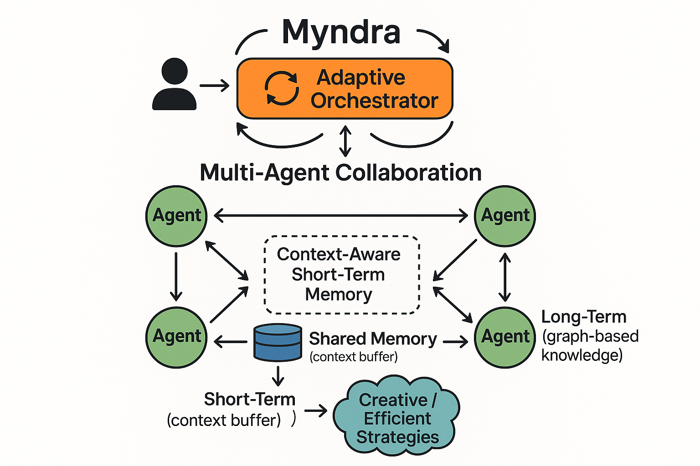
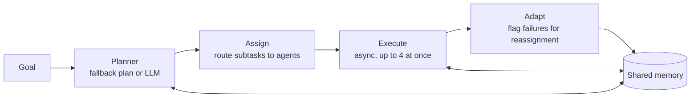
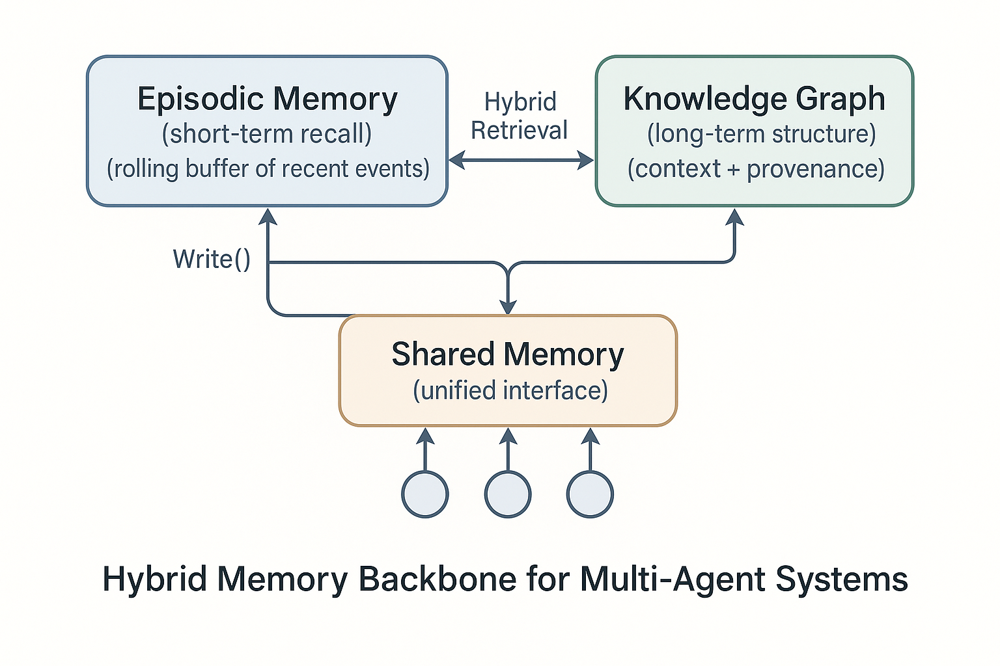
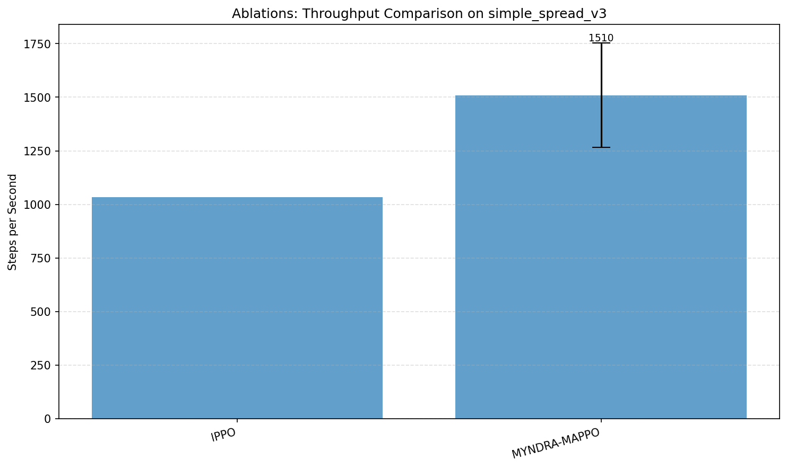

<div align="center">

# Myndra

**A multi-agent playground: an orchestrator that plans, routes, and adapts a team of agents<br>over a hybrid shared memory, plus a small PPO testbed for planner-conditioned MARL.**

[](https://github.com/ysham123/Myndra/actions/workflows/python-tests.yml)


[Orchestrator](#orchestrator) · [Shared memory](#hybrid-shared-memory) · [MARL testbed](#marl-testbed) · [Quick start](#quick-start) · [Layout](#repository-layout)

</div>

---

<p align="center">
  
</p>

Myndra has two parts that grew out of the same question: how should a team of agents divide up a goal and share what they learn?

| Part | What it is | Entry point |
| --- | --- | --- |
| **Orchestrator** | Decomposes a goal into subtasks, routes them to specialist agents, runs them concurrently, and flags failed tasks for reassignment | [`main.py`](main.py) |
| **Hybrid shared memory** | A rolling episodic buffer per agent plus a typed knowledge graph, behind one read/write interface | [`memory/memory_module.py`](memory/memory_module.py) |
| **MARL testbed** | Shared-parameter PPO on PettingZoo's cooperative navigation task, with an optional context vector appended to each observation | [`scripts/run_marl.py`](scripts/run_marl.py) |

## Orchestrator



- **Planning.** By default the orchestrator uses a fixed four-step plan with explicit dependencies. Set `MYNDRA_USE_LLM=1` to use the memory-aware LLM planner, which returns structured `{task, agent, confidence}` subtasks. The model is set with `MYNDRA_PLANNER_MODEL`. A simple keyword-based `Planner` is also included.
- **Routing.** Each subtask goes to the agent the planner names, or falls back to keyword routing.
- **Agents.** `DataAgent`, `AnalystAgent`, `SummarizerAgent`, `GeneralAgent`, and `MoldableAgent` share a `BaseAgent` lifecycle (act, reflect) and can be adjusted between rounds through `mold(feedback)`.
- **Execution and adaptation.** Assignments run concurrently through a small async runtime. Tasks whose output reports an error are marked for reassignment, and every step is written to shared memory and timed by the profiler.

## Hybrid shared memory

<table>
<tr>
<td width="50%"></td>
<td width="50%"></td>
</tr>
</table>

| Layer | Holds | Retrieval |
| --- | --- | --- |
| **Episodic memory** | A bounded, timestamped buffer of recent events per agent | Most recent `n`, or substring match |
| **Knowledge graph** | Nodes for content and context, with typed edges (`ASSIGNED_TO`, `CREATED`, `SUMMARIZED`, `DERIVED_FROM`, `MENTIONS`, `NEXT`) | Neighbourhood traversal to a set depth |
| **SharedMemory** | One `write` that updates both layers | `retrieve` merges episodic hits and graph neighbours |

```python
from memory.memory_module import SharedMemory

memory = SharedMemory()
memory.write("alice", "Started task 12", "Kickoff")
memory.retrieve("alice", "task 12")      # episodic matches + related graph nodes
memory.get_recent("alice", n=1)
```

## MARL testbed

The testbed trains a shared-parameter PPO policy on PettingZoo's `simple_spread_v3` (3 agents cover 3 landmarks). The planner variant appends a small context vector to each agent's observation.

| Feature | Detail |
| --- | --- |
| Algorithm | PPO with a clipped objective and one shared actor-critic for all agents |
| Context | Optional vector appended to every observation, updated every `--interval` steps |
| Throughput | Multi-actor rollouts (`--actors 1 2 4 8`), AMP and `torch.compile` toggles, profiling |
| Analysis | Multi-seed runner, learning curves, AUC with 95% CI, actor scaling, ablation plots |

> [!NOTE]
> **What the current testbed does and does not show.** The context comes from a stub planner that cycles a one-hot vector on a fixed schedule. It is the same for every agent and does not depend on the environment state. The default runs are 5,000 steps, which with the current update schedule is only a few PPO updates. In these runs the planner variant has not separated from the baseline, and the rewards stay near their untrained level. Treat the testbed as infrastructure (rollouts, profiling, multi-seed analysis), not as evidence about planning. A redesigned follow-up with a state-aware planner and matched controls is in progress as a separate project.

<details>
<summary><strong>Saved results and plots</strong></summary>

| Method | Seeds | Steps | AUC (mean, 95% CI) |
| --- | ---: | ---: | --- |
| Baseline (no context) | 5 | 5,000 | 4325 [4198, 4453] |
| Planner context | 3 | 5,000 | not computed |

Raw per-seed metrics, summaries, and figures are in [`results/marl/simple_spread_v3/`](results/marl/simple_spread_v3).

<p align="center"></p>

</details>

## Quick start

```bash
git clone https://github.com/ysham123/Myndra.git
cd Myndra
python3 -m venv venv && source venv/bin/activate
pip install -r requirements.txt
```

**Orchestrator**

```bash
python main.py                           # fixed fallback plan
MYNDRA_USE_LLM=1 python main.py          # LLM planner (needs OPENAI_API_KEY)
```

**MARL testbed**

```bash
python scripts/run_marl.py --env simple_spread_v3 --method ippo --seeds 5 --steps 5000 --actors 4
python scripts/run_marl.py --env simple_spread_v3 --method myndra_mappo --seeds 5 --steps 5000 --actors 4 --interval 32 --context-dim 4

python scripts/plot_curves.py --env simple_spread_v3 --method ippo
python scripts/plot_scaling.py --env simple_spread_v3 --method ippo --actors 1 2 4 8
python scripts/plot_ablations.py --env simple_spread_v3 --methods ippo myndra_mappo
```

| Flag | Values | Meaning |
| --- | --- | --- |
| `--method` | `ippo`, `myndra_mappo` | Baseline, or baseline plus the context vector |
| `--actors` | `1`, `2`, `4`, `8` | Parallel rollout environments |
| `--interval` | int, default 32 | Steps between context updates |
| `--context-dim` | int, default 4 | Size of the context vector |
| `--planner-cache` | `on`, `off` | Reuse the context between updates |
| `--amp`, `--compile` | `on`, `off` | Mixed precision and `torch.compile` |
| `--target-return` | float | Log time to reach a target mean reward |

**Tests**

```bash
pytest -v
```

## Repository layout

| Path | Contents |
| --- | --- |
| [`orchestrator/`](orchestrator) | Orchestrator, rule-based planner, and LLM planner adapter |
| [`agents/`](agents) | Agent base class, specialist agents, and registry |
| [`memory/`](memory) | Episodic memory, knowledge graph, and the shared-memory interface |
| [`systems/`](systems) | Profiler and async runtime |
| [`marl/`](marl) | Environment wrapper and PPO trainer |
| [`scripts/`](scripts) | Multi-seed runner and plotting |
| [`results/`](results) | Saved metrics, profiles, and figures |
| [`tests/`](tests) | Memory, knowledge-graph, and environment tests |
| [`MYNDRA_V2_SUMMARY.md`](MYNDRA_V2_SUMMARY.md) | Implementation notes for the MARL testbed |

---

<p align="center"><sub>Yosef Shammout</sub></p>
